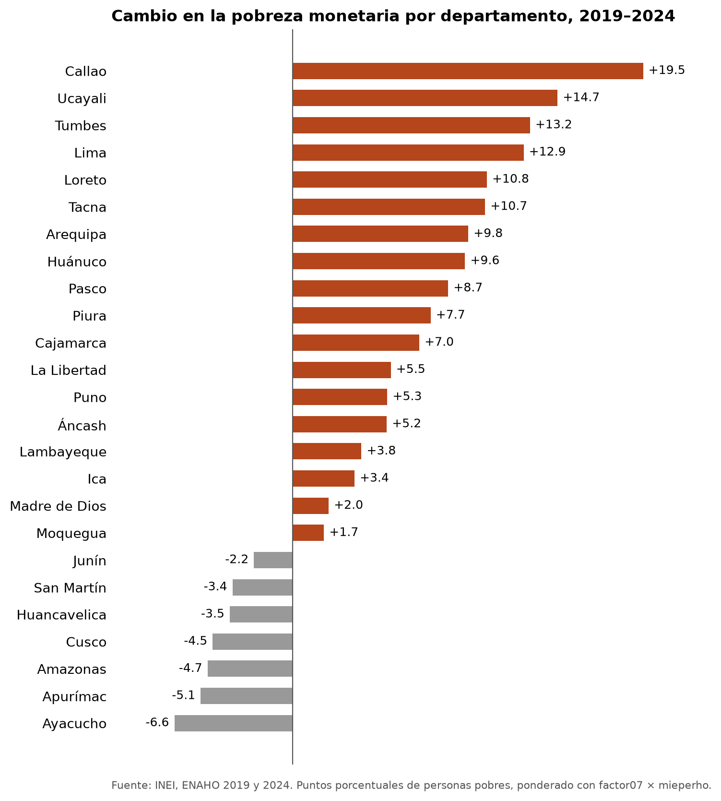

# Agente de datos del Perú

Agente de investigación socioeconómica con datos oficiales del Perú. Junta en Claude Code un servidor MCP con tres
fuentes (las series del **BCRP**, el portal de **microdatos del INEI** y el **Censo 2017 en REDATAM**) y cinco skills
que descargan, limpian, grafican, mapean y cruzan la **ENAHO**. Cada cifra sale de una herramienta que se puede volver
a correr, no de la memoria del modelo.

Tarea 4 del curso Python Intermedio (Data Science con Python, d2cml-ai).



## La pregunta que responde

> ¿Por qué la pobreza monetaria de 2024 sigue por encima de la de 2019, y a qué departamentos golpeó más?

La respuesta completa está en [`informes/informe_final.md`](informes/informe_final.md). En corto:

- Entre diciembre de 2019 y diciembre de 2024 los alimentos subieron 31.9 % y el IPC general 23.9 % (BCRP). La línea
  de pobreza pasó de S/ 351.7 a S/ 454.4 por persona al mes.
- La pobreza pasó de 20.2 % a 27.6 %. El aumento fue urbano (de 14.6 % a 24.8 %); la pobreza rural bajó un poco
  (de 40.8 % a 39.3 %).
- Empeoraron sobre todo Callao (+19.5 puntos) y Lima (+12.9). La falta de agua por red pública del Censo 2017 se
  asocia con dónde la pobreza es alta (r = 0.52), no con dónde subió (r = 0.19).

## Cómo está armado

```
.mcp.json                     conecta el servidor "peru" a Claude Code
mcp/server.py                 el servidor MCP: BCRP, microdatos INEI y REDATAM
mcp/test_server.py            10 pruebas: las 8 de la sesión 04 y 2 propias
.claude/skills/               cinco skills (cuatro de la sesión 16 y una propia)
evaluacion/                   10 preguntas, el script que las corre y los resultados
informes/                     informe final y la respuesta del agente
salidas/ figuras/ mapas/      lo que producen las herramientas
evidencias_ia/                la corrida del agente y el historial con la IA
datos/                        microdatos crudos (no se suben: .gitignore)
```

### El servidor MCP (`mcp/server.py`)

| Fuente | Herramienta | Qué hace |
|---|---|---|
| BCRP | `buscar_series` | Busca el código de una serie entre las 17 mil del catálogo |
| | `serie` | Los datos de una serie entre dos fechas |
| | `resumen` | Primero, último, cambio, variación, promedio, máximo y mínimo |
| | `graficar_series` **(propia)** | Gráfico de líneas en `figuras/` y los datos en `salidas/` |
| Banco Mundial | `comparar_paises` **(propia)** | Compara al Perú con otros países |
| Microdatos INEI | `encuestas_inei` **(propia)** | Las ~60 encuestas y censos del portal |
| | `modulos_inei` **(propia)** | Los módulos de una encuesta en un año, con sus códigos |
| | `descargar_modulo_inei` **(propia)** | Baja y descomprime un módulo en `datos/inei/` |
| Censo 2017 | `variables_redatam` **(propia)** | Las variables del censo, con el nombre listo para el programa |
| | `consultar_redatam` **(propia)** | Corre un programa REDATAM en el servidor del INEI y guarda la tabla |

Además tiene un *resource* (`bcrp://serie/{codigo}`, la ficha de una serie) y un *prompt* (`informe`).

El portal de microdatos y el REDATAM del INEI no tienen API. Las herramientas repiten los mismos pedidos que hace la
página web: elegir encuesta, año, periodo y módulo, o enviar un programa al «Procesador Estadístico En-línea». Dos
reglas de REDATAM que aprendimos con los errores del servidor: dentro de un `FOR` los nombres distinguen mayúsculas
(`Vivienda.C2P6`, no `VIVIENDA.C2P6`) y una variable nueva no puede pasar de 10 caracteres.

### Las skills (`.claude/skills/`)

| Skill | Recibe | Entrega |
|---|---|---|
| `descargando-enaho` | Un año | Los módulos 34 y 02 de la ENAHO en `datos/` |
| `limpiando-enaho` | Los `.dta` | `salidas/hogares_<año>.parquet`, `personas_<año>.parquet` y `validacion.txt` |
| `graficando-enaho` | La base limpia y un grupo | Barras en `figuras/` |
| `mapeando-enaho` | La base limpia | Mapa por departamento en `mapas/` |
| `cruzando-fuentes` **(propia)** | ENAHO de dos años y el censo (vía `consultar_redatam`) | `salidas/indicadores.csv` y el gráfico del cambio por departamento |

La limpieza valida contra la cifra oficial del INEI antes de entregar nada: 27.58 % en 2024 y 20.19 % en 2019, con
108,664 residentes habituales en 2024 ([`salidas/validacion.txt`](salidas/validacion.txt)).

## Evaluación

Diez preguntas con respuesta verificada (tres del BCRP, cuatro de la ENAHO, dos del censo y una del portal de
microdatos), hechas a Claude Code con y sin el MCP y las skills:

| Modo | Acierta | No sabe | Se equivoca |
|---|---|---|---|
| Sin herramientas (solo memoria) | 1 | 8 | 1 |
| Con el MCP y las skills | **10** | 0 | 0 |

Sin herramientas, el modelo casi siempre reconoció que no sabía; la vez que respondió una cifra del censo, se
equivocó en 10 % sin dudar. El detalle, los límites y cómo repetirla están en
[`evaluacion/comparacion.md`](evaluacion/comparacion.md).

## Cómo usarlo

Necesitas [uv](https://docs.astral.sh/uv/) y [Claude Code](https://claude.com/claude-code).

```bash
git clone https://github.com/Jhane080/agente-datos-peru.git
cd agente-datos-peru
uv sync
uv run pytest
claude
```

Dentro de Claude, pide en tus palabras:

- «¿Cuánto subieron los alimentos desde 2019 según el BCRP?»
- «Haz un mapa de la pobreza 2024 por departamento»
- «¿Qué porcentaje de viviendas de Loreto no tenía agua por red pública en el censo?»
- «Baja el módulo de características del productor de la ENA 2025»

La primera vez, Claude Code pide aprobar el servidor `peru` de `.mcp.json`.
