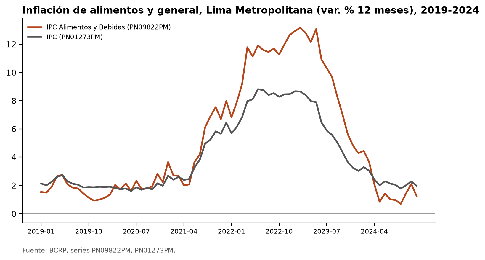
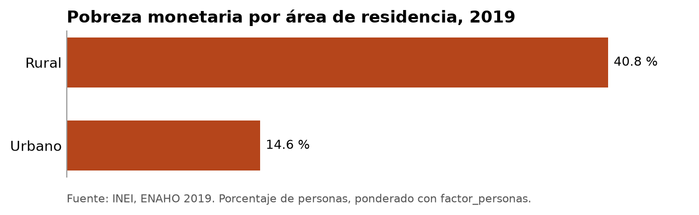
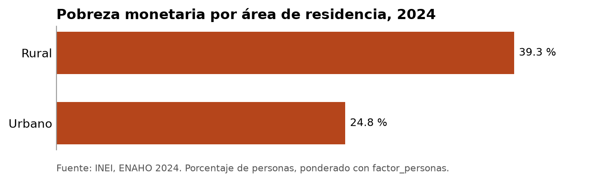
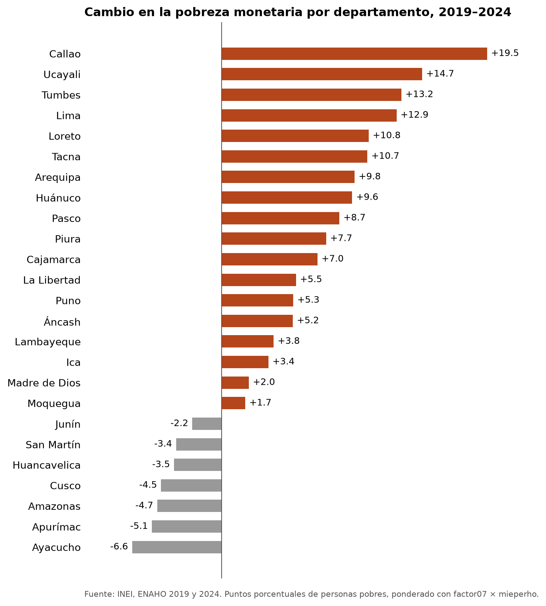
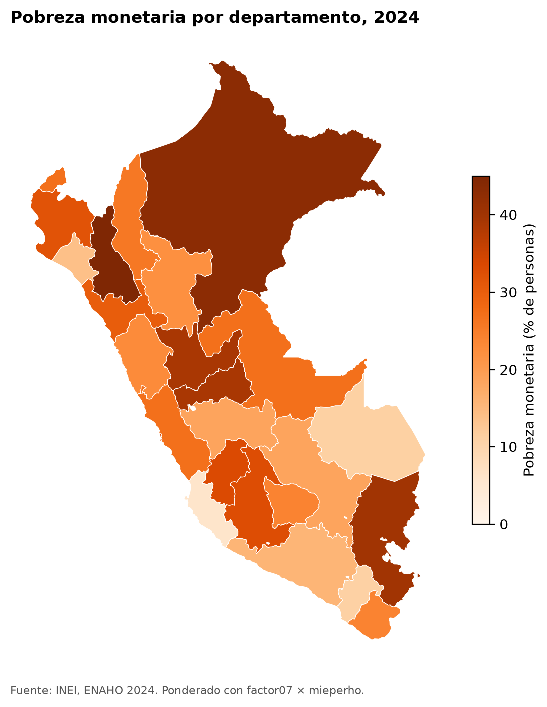
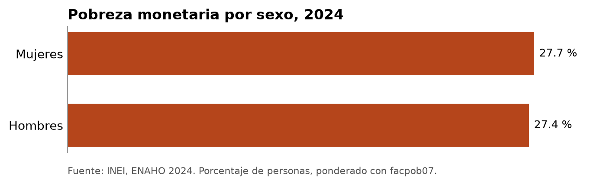
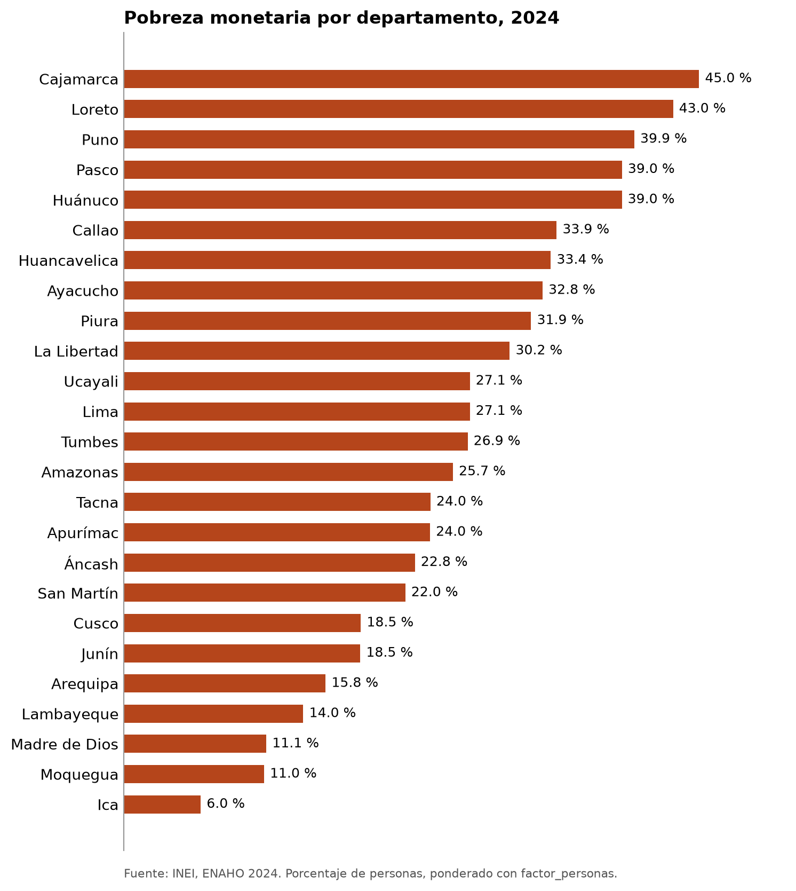

# La pobreza después de la pandemia: precios, ciudades y territorio

**Pregunta de investigación.** ¿Por qué la pobreza monetaria de 2024 sigue por encima de la de 2019, antes de la
pandemia, y a qué departamentos golpeó más?

**Respuesta corta.** Entre 2019 y 2024 la pobreza subió de 20.2 % a 27.6 % de la población. El costo de la canasta
básica subió 29 %, más que los precios en general (24 %), y los alimentos subieron más que todo lo demás. El
aumento de la pobreza se concentró en las ciudades: la pobreza urbana subió 10.2 puntos, mientras que la rural
bajó 1.5 puntos. Por eso los departamentos que más empeoraron son urbanos y costeños, sobre todo Callao y Lima, y
no los que tenían más carencias de servicios en el Censo 2017.

Todas las cifras salen de herramientas del proyecto: ninguna se escribió a mano. Están en
[`salidas/indicadores.csv`](../salidas/indicadores.csv) y en
[`salidas/inflacion_2019_2024.csv`](../salidas/inflacion_2019_2024.csv).

## Datos y herramientas

| Fuente | Qué se usó | Cómo se obtuvo |
|---|---|---|
| BCRP | IPC de Lima: índices (dic. 2021 = 100) y variación 12 meses, 2019–2024 | MCP: `buscar_series`, `resumen`, `graficar_series` |
| INEI, ENAHO 2019 y 2024 | Módulo 34 (sumaria) y 02 (miembros) | Skills `descargando-enaho`, `limpiando-enaho`, `graficando-enaho`, `mapeando-enaho` |
| INEI, Censo 2017 | Abastecimiento de agua de las viviendas (`C2P6`), por departamento | MCP: `consultar_redatam` |
| Cruce de las tres | Cambio por departamento, línea de pobreza y correlaciones | Skill propia `cruzando-fuentes` |

Las dos bases de la ENAHO replican la cifra oficial del INEI con una diferencia menor a 0.1 puntos: 20.19 % en 2019
y 27.58 % en 2024 ([`salidas/validacion.txt`](../salidas/validacion.txt) y
[`salidas/validacion_2019.txt`](../salidas/validacion_2019.txt)). Todas las tasas están ponderadas con
`factor07 × mieperho`, como las calcula el INEI.

## Hallazgo 1. La canasta básica se encareció más que el resto de la economía

Entre diciembre de 2019 y diciembre de 2024 el IPC de Lima subió **23.9 %** (serie `PN38705PM`). Los alimentos y
bebidas subieron **31.9 %** (`PN39445PM`) y todo lo que no es alimento, **18.7 %** (`PN38706PM`). La inflación
de alimentos llegó a **13.2 %** anual en febrero de 2023 (`PN09822PM`), cuando la general tocó techo en
**8.8 %** en junio de 2022 (`PN01273PM`).



La ENAHO muestra lo mismo desde el lado de los hogares. La línea de pobreza, el costo mensual de la canasta básica
por persona, pasó de **S/ 351.7 a S/ 454.4** (+29.2 %). La línea de pobreza extrema, que es solo la canasta de
alimentos, pasó de **S/ 187.2 a S/ 255.6** (+36.5 %). Un hogar necesitaba en 2024 casi un tercio más de soles que
en 2019 solo para no ser pobre. Si sus ingresos no crecieron al mismo ritmo, cruzó la línea.

## Hallazgo 2. La pobreza creció en las ciudades, no en el campo

| | 2019 | 2024 | Cambio (puntos) |
|---|---|---|---|
| Perú | 20.2 % | 27.6 % | +7.4 |
| Urbano | 14.6 % | 24.8 % | **+10.2** |
| Rural | 40.8 % | 39.3 % | −1.5 |
| Pobreza extrema urbana | 1.0 % | 3.1 % | +2.2 |
| Pobreza extrema rural | 9.8 % | 15.5 % | +5.7 |




El campo sigue siendo más pobre, pero el aumento de 2019 a 2024 viene casi entero de las ciudades. Una lectura
coherente con el hallazgo 1: en la ciudad casi todo lo que se come se compra, así que el alza de los alimentos pega
de lleno; en el campo una parte se produce en casa. Hay un matiz: aunque la pobreza rural total bajó un poco, la
pobreza **extrema** rural subió de 9.8 % a 15.5 %. Los hogares rurales que ya eran pobres se hundieron más.

## Hallazgo 3. Empeoraron la costa urbana y la Amazonía baja; mejoró la sierra sur, y el agua no lo explica

La pobreza subió en 18 de los 25 departamentos. Los que más subieron fueron **Callao (+19.5 puntos, de 14.3 % a
33.9 %)**, Ucayali (+14.7), Tumbes (+13.2) y **Lima (+12.9, de 14.2 % a 27.1 %)**. Bajó en siete, todos de sierra
o selva alta: Ayacucho (−6.6), Apurímac (−5.1), Amazonas (−4.7), Cusco (−4.5), Huancavelica (−3.5), San Martín
(−3.4) y Junín (−2.2).



En 2024 los más pobres siguen siendo Cajamarca (45.0 %), Loreto (43.0 %) y Puno (39.9 %).



El Censo 2017 ayuda a separar dos preguntas. Los departamentos con más viviendas sin red pública de agua, como Puno
(52.8 %), Loreto (49.9 %) y Huánuco (41.2 %), son en general los más pobres: la correlación entre esa carencia y la
pobreza de 2024 es **0.52**. Pero la correlación con el **aumento** de la pobreza es apenas **0.19**. Callao y Lima,
donde más subió la pobreza, son de los que tienen menos viviendas sin red (11.7 % y 12.5 %). La falta de servicios
explica dónde está la pobreza de siempre; el golpe de 2019–2024 vino por otro lado, el de los precios y los ingresos
urbanos.

Otros cortes de la ENAHO 2024, hechos con la skill `graficando-enaho`: por sexo la pobreza casi no cambia (mujeres
27.7 %, hombres 27.4 %), y por departamento el orden es el del mapa.




## Verificación de las cifras

Seis afirmaciones del informe, comprobadas por un camino distinto al de la herramienta que las produjo.

| Afirmación | Valor calculado | Cómo se verificó | ¿Coincide? | Diferencia |
|---|---|---|---|---|
| Pobreza monetaria 2024 | 27.58 % (skill `limpiando-enaho`) | Cifra oficial del INEI: 27.6 % | Sí | 0.02 puntos |
| Pobreza urbana y rural 2024 | 24.81 % y 39.30 % (skill `cruzando-fuentes`) | Valores de referencia del enunciado: 24.8 % y 39.3 % | Sí | menos de 0.01 puntos |
| Residentes habituales 2024 | 108,664 (skill `limpiando-enaho`) | Valor de referencia del enunciado: 108,664 | Sí | 0 |
| Pobreza monetaria 2019 | 20.19 % (skill `limpiando-enaho`) | Cifra oficial del INEI: 20.2 % | Sí | 0.01 puntos |
| Alimentos y bebidas, dic-2019 a dic-2024 | +31.94 % (MCP `resumen`, `PN39445PM`) | A mano con los dos índices de la serie: 119.5292 / 90.5906 − 1 = 31.94 % | Sí | 0 |
| IPC general, dic-2019 a dic-2024 | +23.91 % (MCP `resumen`, `PN38705PM`) | A mano: 114.1721 / 92.14 − 1 = 23.91 % | Sí | 0 |

Los controles completos de la limpieza (duplicados, unión m:1, ubigeos de 6 dígitos, 25 departamentos, factores) están
en [`salidas/validacion.txt`](../salidas/validacion.txt) y [`salidas/validacion_2019.txt`](../salidas/validacion_2019.txt),
cada uno marcado como aprobado o fallido.

## Lo que estos datos no permiten concluir

- **No prueban que la inflación causó la pobreza.** Muestran que suben juntas y por un camino coherente. En el
  mismo periodo hubo pandemia, pérdida de empleo, recesión en 2023 e inestabilidad política, y este análisis no los
  separa.
- **El IPC es de Lima Metropolitana.** Los precios de otras ciudades pudieron subir distinto. La línea de pobreza
  sí cambia por dominio, y su aumento coincide con el del IPC.
- **Las cifras por departamento tienen márgenes de error amplios**, sobre todo en los de muestra chica como Callao,
  Tumbes o Madre de Dios. El INEI publica la pobreza departamental en grupos por esa razón. Los cambios de pocos
  puntos no deben leerse como diferencias firmes.
- **El censo es de 2017.** Sirve como punto de partida, no como foto de 2024. Y 25 departamentos son pocos datos
  para una correlación: describe, no demuestra.

## Cómo reproducirlo

```bash
uv sync
uv run pytest
claude -p "$(cat evidencias_ia/pregunta_integrada.txt)"
```

La corrida del agente que respondió la pregunta, con cada llamada a herramientas MCP y skills, está en
[`evidencias_ia/corrida_integrada.jsonl`](../evidencias_ia/corrida_integrada.jsonl), y su respuesta en
[`informes/respuesta_agente.md`](respuesta_agente.md).
